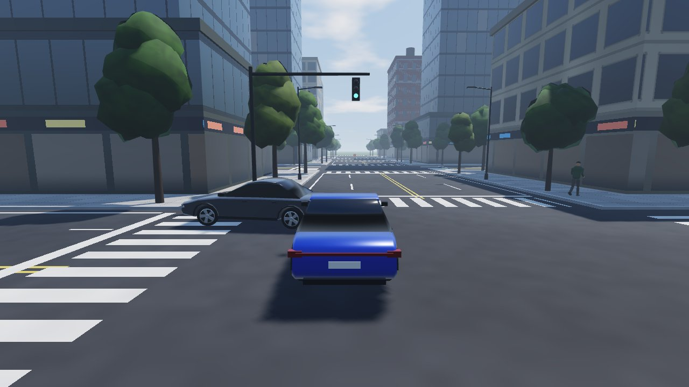
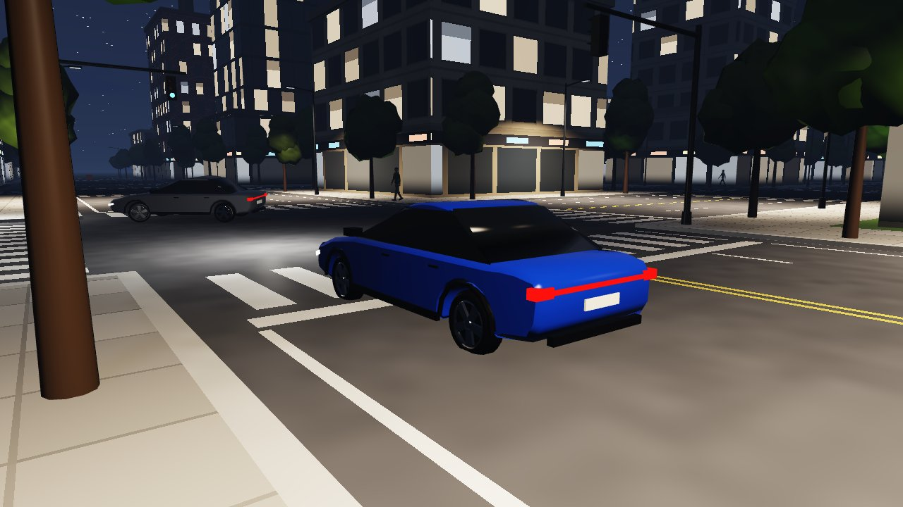
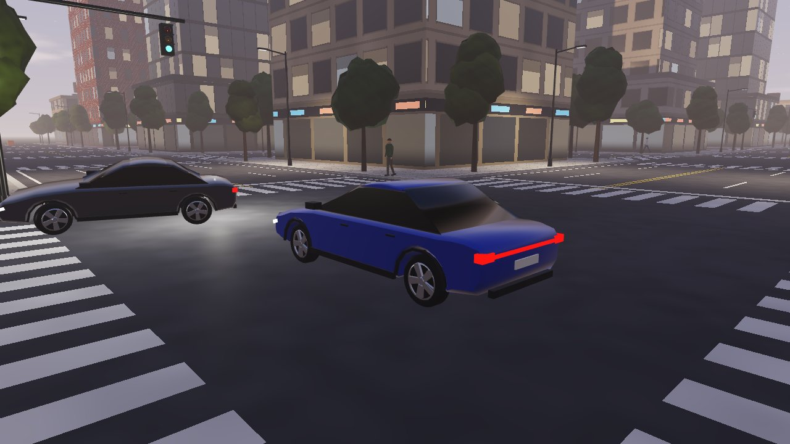
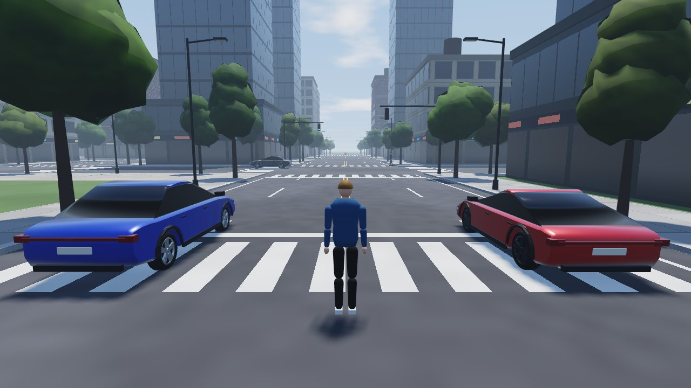
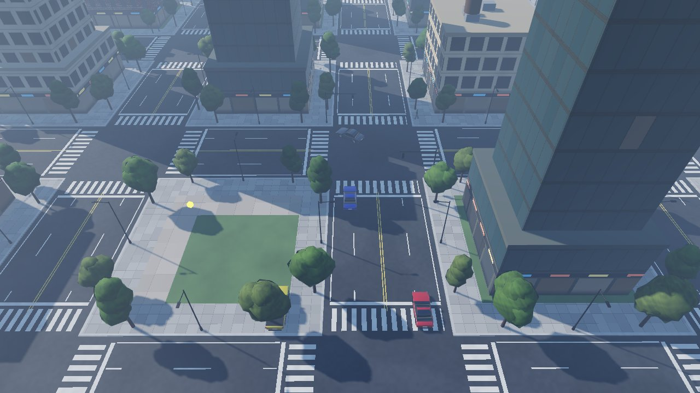
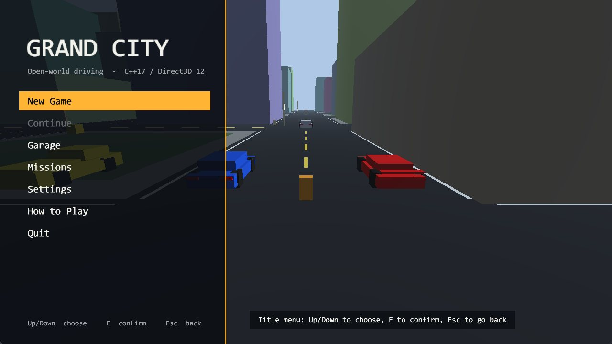
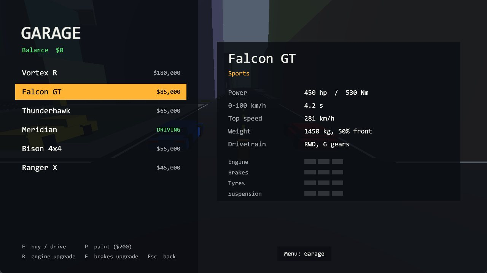

# Grand City — open-world driving game and engine in C++17



An open-world driving game in C++17: a fictional coastal city, six original
story missions, six buyable cars with real handling, a garage with upgrades,
50 hidden packages, 10 stunt jumps, police chases with roadblocks, weather,
day/night, radio, and a complete menu flow from title screen to credits.

Original content only — fictional city, cars and characters. No third-party
game content, assets or branding, and no real car brands, badges or licensed
models appear anywhere.

| Night, street lamps and headlights | Golden hour |
|---|---|
|  |  |
| **On foot** | **Above the city** |
|  |  |
| **Title menu** | **Garage** |
|  |  |

Every image above is a real frame from the Direct3D 12 renderer, captured
in-engine with `--shot` (see *Screenshots* below). Everything you see is
built in code at start-up: no meshes, textures or photos are loaded.

## Finished game — how to play start to finish

1. **Title menu** (Up/Down + E to choose): New Game, Continue (if a save
   exists), Garage, Missions, Settings, How to Play, Quit.
2. **New Game** opens with the story intro: you are a new driver in Grand
   City. Ray needs a package moved, Mara knows every street, and the police
   know every face.
3. **Story campaign** — six missions in order, each with a short in-engine
   cutscene (camera moves + dialogue). Finishing a mission unlocks the next
   one, unlocks a car, and earns 1–3 stars (3 = fast and clean). Mission
   select shows locked / unlocked / complete + stars.
4. **Free roam** between missions: collect the 50 hidden packages ($50
   each), hit the 10 stunt jumps (air-time scoring), earn taxi fares, run
   time trials, and buy cars and upgrades in the garage.
5. **Game complete** — finish all six missions to see your stats (missions,
   money, packages, best stunt, play time) and the credits.
6. **Pause menu** (Esc): Resume, Settings, Save & Quit to Menu. The game
   saves to `savegame.json` (position, money, cars owned, upgrades, mission
   progress, stars, wanted level, time of day, collectibles, best stunt).

## Controls

| Key | Action |
|---|---|
| W / A / S / D (or arrows) | Drive or walk |
| Space | Brake (driving) / jump (on foot); hold + steer at speed = handbrake turn |
| Shift | Run (on foot) / Shift+F = debug overlay |
| E | Enter / exit car; confirm in menus |
| Up / Down | Move in menus |
| F | Switch camera (chase / hood / cockpit) |
| P | Photo mode (freeze time, free camera with arrows, hide HUD) |
| R | Switch radio station |
| M | Mute |
| Esc | Pause menu / back |

## The six cars (all fictional, no real brands)

| Car | Class | Power | 0–100 | Top speed | Drive | Price |
|---|---|---|---|---|---|---|
| Vortex R | Supercar (mid-engine) | 640 hp | 2.9 s | 342 km/h | AWD | $180,000 |
| Falcon GT | Sports coupe | 450 hp | 4.2 s | 281 km/h | RWD | $85,000 |
| Thunderhawk | Muscle car | 480 hp | 4.5 s | 252 km/h | RWD | $65,000 |
| Meridian | Sedan | 300 hp | 7.0 s | 198 km/h | RWD | free (starter) |
| Bison 4x4 | SUV | 400 hp | 6.5 s | 180 km/h | AWD | $55,000 |
| Ranger X | Pickup | 350 hp | 7.5 s | 173 km/h | 4x4 | $45,000 |

Full specs (torque curve, weight, weight distribution, gear ratios) are in
`data/cars.json`. Each car has a distinct procedural model: silhouette,
turning front wheels, headlights/taillights, mirrors, spoiler (sporty
classes), rims, and a cockpit interior with a steering wheel that turns
with your input. Engine sounds differ per car type (pitch by RPM).

**Garage upgrades** (per car, 3 levels each): Engine (+12% power/level),
Brakes (+20% braking/level), Tyres (+8% grip/level), Suspension (+15%
stiffness/level). Upgrades really change how the car drives. Paint costs
$200.

## The six story missions

1. **Harbour Delivery** — drive the package to the harbour in time. ($500)
2. **City Pickup** — collect 5 packages across the city. ($750)
3. **Lose the Heat** — lose a 3-star wanted level, reach the safehouse. ($1,000)
4. **City Taxi** — pick up 3 fares and drop them off on time. ($900)
5. **Four-Star Escape** — survive 120 seconds at 4 stars, reach the hideout. ($1,500)
6. **Stunt Show** — score 3.0 seconds of total air time off the ramps. ($1,200)

Side activities: 50 hidden packages, 10 stunt jumps, taxi fares, time
trials. Weather: clear / rain (wet roads cut grip ~30%) / fog, selectable
in Settings.

## What is in here

| Area | What it does |
|---|---|
| Game flow | Title / Settings / Garage / Mission Select / How to Play / Loading / Pause / Mission Complete & Failed / Game Complete — every button does something real |
| Story | Original 6-mission campaign with cutscenes, unlocks, star ratings (`src/game/story.h`) |
| Engine | Fixed 60 Hz physics loop, Win32 window, resource manager, scene graph, ECS + job system |
| Renderers | Direct3D 12 (Windows, playable), Null (headless/Linux/CI), Vulkan (Windows + SDK, partial), Metal (macOS, minimal stub) |
| Rendering (D3D12) | Physically based lighting (GGX specular, Schlick Fresnel, clear-coat car paint), 2048² sun shadow map with 3×3 PCF, 4× MSAA, ACES tone mapping; procedural sky with sun, moon, clouds and stars; 16 point lights (street lamps cast downward pools, headlights, police bars); day/night cycle with golden hour and lit windows; wet roads in rain; 2D overlay for menus, HUD and minimap |
| Procedural city | Concrete, glass, brick and stone facades with shopfronts and signs; podium towers with crowns, rooftop plant and blinking aircraft lights; asphalt with lane markings, zebra crossings and kerbs; pavements with street lamps, trees and traffic signals |
| Procedural cars and people | Eight body styles (sedan, hatch, sports, supercar, muscle, SUV, pickup, van) lofted from side profiles with wheel arches, separate glass, grille, mirrors, plates, light bars and five-spoke rims; articulated pedestrians with a walk cycle who use the pavements and crossings |
| Shader library | Standalone PBR, shadow and post-processing shaders in `shaders/` for the Vulkan path, validated by the null renderer; the D3D12 shader lives in `src/renderer/d3d12/d3d12_shaders.h` |
| Physics | Full drivetrain (torque curve, gearbox, clutch slip, differential), Pacejka tyres, per-wheel raycast suspension, weight transfer, aero drag + downforce, brake fade, ABS/TC/ESP assists, surface grip (tarmac/wet/gravel), damage model, OBB + swept collision |
| AI | A* pathfinding on the road graph for traffic and police, lane-changing, yielding at intersections, pedestrian avoidance, police roadblocks at 3+ stars |
| Audio | Vendored miniaudio: positional engine/skid/siren/crash/backfire/pickup sounds + 3-station synthesised radio |
| Save/load | JSON save file with money, cars, upgrades, missions, stars, collectibles, wanted, time of day |
| Scripting | Lua 5.4 mission scripts (`gc6_*` globals + `game.*` table) with safe error handling and hot-reload |
| Networking | Minimal UDP snapshot protocol + loopback test (foundation only, not multiplayer) |
| Tools | Python build wrapper, level generator, asset checker, shader compiler, profiler summariser, headless playthrough check |

## Requirements

- **Windows 10/11** to play the real game: Visual Studio 2022 (C++ workload),
  Windows SDK (10.0.19041 or newer), CMake 3.20+, Git.
- **Vulkan SDK** (optional): only needed for `-DGC6_RENDERER=vulkan`.
- **Linux/macOS**: the project configures and builds with the **null renderer**
  (headless — game logic runs, no pixels). This is how the automated tests run.
- **RenderDoc / PIX** (optional): for frame capture; see `docs/RENDERDOC_PIX.md`.

## Build (Windows, PowerShell)

```powershell
python tools/build.py --renderer d3d12 --config Release
# then run, from the project root:
.\build\Release\grand-city-6.exe
```

Or by hand:

```powershell
cmake -S . -B build -DGC6_RENDERER=d3d12 -DCMAKE_BUILD_TYPE=Release
cmake --build build --config Release -j
```

Renderer choices: `-DGC6_RENDERER=d3d12` (default on Windows),
`-DGC6_RENDERER=vulkan` (needs the Vulkan SDK), `-DGC6_RENDERER=null`.

## Build (Linux — null renderer + tests)

```bash
python tools/build.py --renderer null --config Release
ctest --test-dir build --output-on-failure
# or run the game headless for 600 frames (600 fixed physics steps):
./build/grand-city-6 --headless --frames 600
# summarise the profile log it writes on exit:
python tools/profiler.py
# full headless playthrough check:
python tools/playthrough.py
```

## Project layout

```
CMakeLists.txt          top-level build (C++17, FetchContent: glm, Lua 5.4)
src/core/               math (glm), logger, config, clock, events, arena, input, jobs, ecs, profiler
src/engine/             Application, Window (Win32 / null), ResourceManager, Scene
src/renderer/           IRenderer + null / D3D12 / Vulkan / Metal backends, PBR materials, post, lights
src/renderdoc/          in-engine RenderDoc capture markers
src/physics/            Vehicle, Character, AABB/OBB collision, drivetrain, tires (Pacejka)
src/game/               City, Traffic, Pedestrians, Player, Police/Wanted, Missions, World,
                        Story, Menus, Garage/Economy, Savegame, Weather, Collectibles
src/scripting/          Lua binding (safe: a Lua error never crashes the engine)
src/audio/              miniaudio (vendored) + AudioEngine + Radio
src/net/                UDP snapshot protocol (foundation only)
shaders/                HLSL (D3D12) + GLSL (Vulkan SPIR-V): lit, lit_pbr, post, sky, unlit
scripts/missions/       6 Lua mission scripts
tools/                  Python: build, level_tool, asset_check, compile_shaders, package,
                        profiler, playthrough
data/                   cars.json (6 cars), city.json, settings.ini, missions.json (6),
                        materials.json (12 PBR materials)
docs/                   ARCHITECTURE.md, PHYSICS.md, SHADERS.md, AUDIO.md, NETWORKING.md,
                        RENDERDOC_PIX.md
tests/                  portable test program (null renderer) — 148 checks
```

## How to add a mission (Lua)

1. Copy `scripts/missions/mission1_delivery.lua` to `mission7_yours.lua`.
2. Set `mission.id`, `name`, `reward`, `timeLimit`; implement `onStart()`,
   `onUpdate(dt)`, and your completion hook.
3. Add it to `data/missions.json` (the C++ side parses it — no code change
   needed for the definition).
4. Available from Lua: legacy globals `gc6_log(msg)`,
   `gc6_setObjective(text)`, `gc6_giveMoney(amount)`, `gc6_setWanted(stars)`,
   and the `game.*` table: `game.setObjective`, `game.setMarker(x, z)`,
   `game.distanceTo(x, z)`, `game.addMoney(n)`, `game.completeMission()`,
   `game.failMission(reason)`, `game.setTimer(s)`, `game.timeLeft()`,
   `game.setWanted(n)`, plus `onStuntJump(airTime)` for stunt missions.

## Screenshots

The game can capture a frame itself, without taking over the desktop:

```powershell
.\build\Release\grand-city-6.exe --shot night.bmp --hour 21.5 --drive 0.6 --wait 240 --no-hud
```

Options: `--hour H` (time of day), `--weather rain`, `--drive T` and
`--steer S` (scripted throttle and steering), `--wait N` (frames before the
capture), `--camera N` (press the camera key N times), `--photo YAW PITCH DIST`
(orbit camera), `--no-hud`. The window opens without taking focus, runs a fixed 60 Hz
simulation, writes a BMP and exits. `startHour` in `data/settings.ini` sets
the time a new game starts at.

## Verification

### Windows (2026-11-20, Windows 11, MSVC 19.44, Direct3D 12)

- Configures and builds with Visual Studio 2022 (`-DGC6_RENDERER=d3d12`),
  zero errors.
- Test suite: **148 checks, 0 failures** (`gc6_tests.exe`).
- Played in the D3D12 renderer: title menu, new game, entering a car,
  driving through the gears, a crash (damage), a police chase (wanted
  stars), garage screen. The screenshots above are from that session.
- Headless run (`--headless --frames 600`): exit 0.

### Linux (2026-11-20, Linux VM, null renderer)

- CMake configure exit 0; build exit 0 with `-Wall -Wextra -Werror`
  (zero warnings in game code).
- Full test suite: **147 checks, 0 failures** (`ctest` 100% passed).
  Includes a full headless playthrough: new game → mission 1 completes →
  supercar bought → save → load → save matches.
- Headless run: 600 frames = 600 fixed physics steps, exit 0, 247,800 draws.
  After the final QA fixes (see `docs/CHANGELOG.md`): 30/30 headless runs
  pass with audio enabled, and the job-system stress test completes
  200,000 `parallelFor` calls (2.8M tasks) without hanging.
- AddressSanitizer + UBSan run of the test suite: no memory errors, no
  undefined behaviour (see `docs/ARCHITECTURE.md` for the leak note).
- Asset check: all required files present, all JSON valid, 6 cars,
  6 missions, all Lua scripts parse.
- No TODO/FIXME/XXX in game code (only in vendored third-party
  `miniaudio.h`, which is not game code).

## Honest limits

- **The look is procedural, not photo-scanned**: lighting, shadows and
  materials are physically based, but buildings, cars and people are built
  from code, so close up they read as clean low-poly models rather than
  photographs. There are no reflections of the actual scene (sky and
  street colour are approximated), no screen-space effects and no textures.
- **The Vulkan backend has not been compiled** (no Vulkan SDK on the build
  machines) and is not feature-complete; Windows builds use D3D12.
- The Metal backend is a **labelled minimal stub** — it needs a Mac with
  MetalKit to complete; macOS builds fall back to the null renderer.
- The UDP multiplayer code is a **foundation only** — the snapshot protocol
  and loopback test are real, but there is no lobby, server, or real-network
  play. The VM used for verification blocks UDP sends, so the live loopback
  is skipped there (the protocol round-trip is tested instead).
- This is a complete, polished, original open-world game built on the
  engine — the closest achievable in this format. It is **not a finished
  AAA game**, and the real graphics need a Windows PC with a Direct3D 12 GPU.
